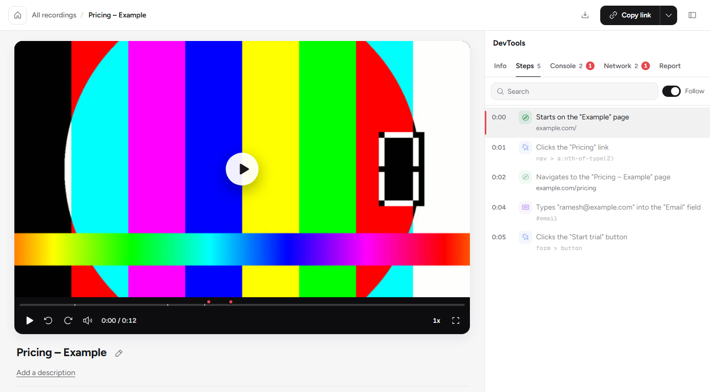
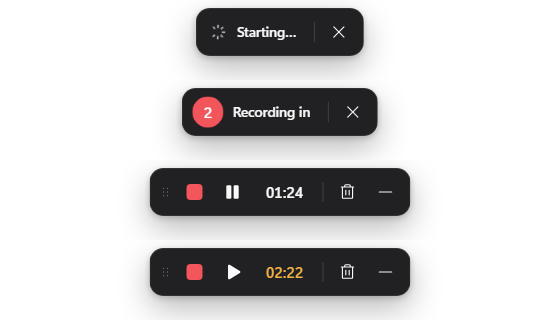
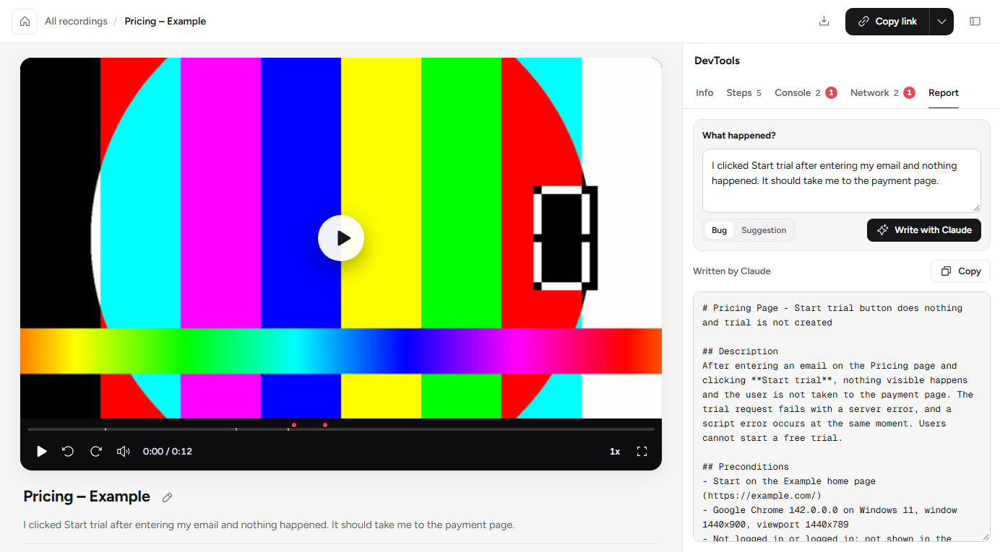
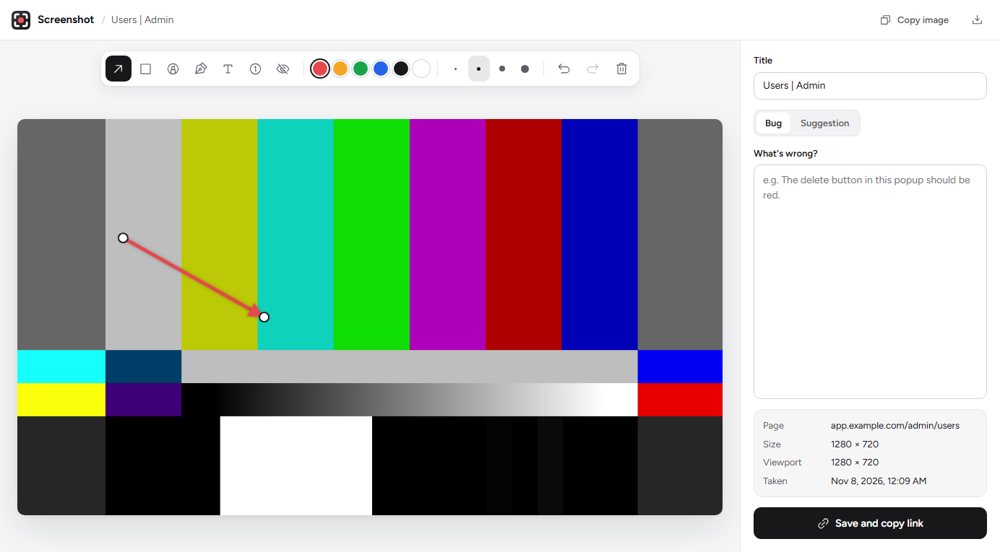
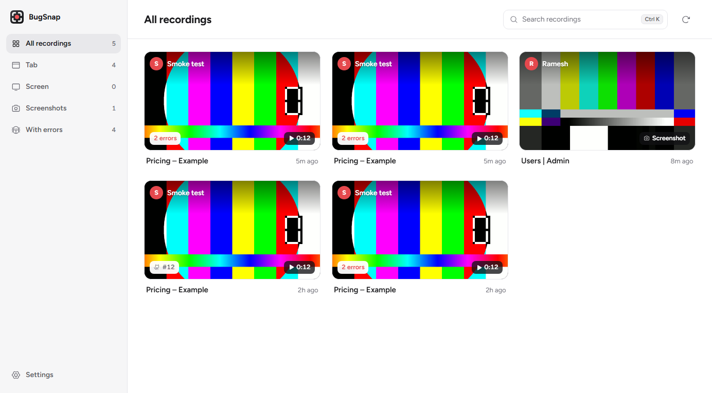
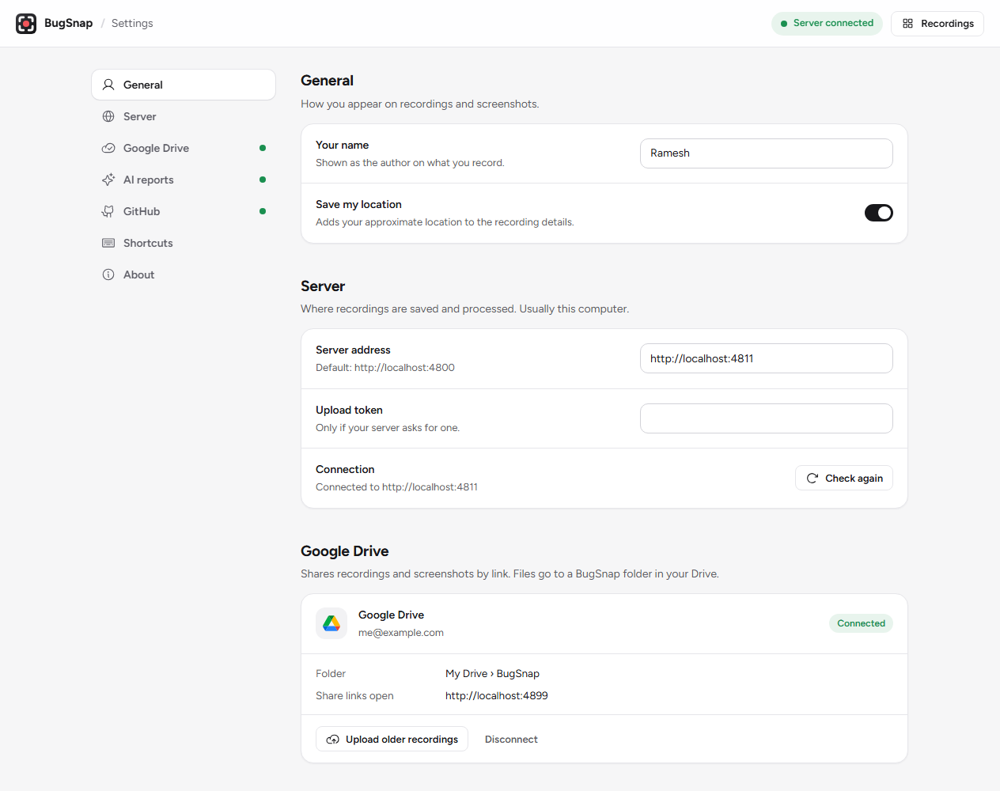
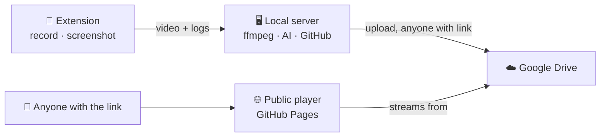

<div align="center">


# BugSnap

**Record a bug once. Share one link with everything a developer needs.**

Screen recordings and screenshots with console logs, network requests, user steps and an AI-written bug report, all in one shareable player.




</div>

---

## Why BugSnap?

Writing a good bug report takes longer than finding the bug. BugSnap does the boring part for you:

| You do | BugSnap does |
|---|---|
| Click **Record this tab** and reproduce the bug | Captures the video, every click and keystroke as plain sentences, console errors, failed requests, browser, OS and screen size |
| Type what went wrong, in any language (English, Sinhala, Singlish…) | Writes a clean English bug report in your team's template |
| Click **Copy link** | Gives you a public link that opens in a fast player, even before the upload finishes |
| Click **Send to GitHub** | Files the issue with labels, assignees and the recording linked |

---

## Features

### 🎥 Record a tab or your whole screen

A small control bar sits at the bottom of the page while you record: countdown, pause, stop and discard. Nothing opens or jumps around when you stop; the bar just says **Saved** with a **Copy link** button.

<p align="center"></p>

### 🧭 A player built for debugging

Video on the left, DevTools on the right, synced to the timeline.

- **Steps**: `Clicks the "Pricing" link`, `Types "…" into the "Email" field`. Click a step to jump to that moment.
- **Console** and **Network**: errors and failed requests are colour-coded and shown as red dots on the progress bar.
- **Info**: browser, OS, window size, time zone and every page visited.
- Keyboard controls (Space, J/L, M, F), resizable panel, and **Copy link at 0:07** to point at an exact moment.

### ✨ AI bug reports

Describe the problem in a sentence, pick **Bug** or **Suggestion**, and click **Write with Claude**. BugSnap combines your words with the steps, errors and environment it captured, and writes:

```
Pricing Page - Start trial button does nothing
[suggestion] Pricing Page - It would be better to …

Description · Preconditions · Steps to reproduce · Attachments · Actual result · Expected result
```

<p align="center"></p>

Choose who writes the report:

| Provider | What you need |
|---|---|
| **Claude Code** (default) | Claude Code installed and signed in. Uses your Claude plan, no API key. |
| **Anthropic** | API key |
| **OpenAI** | API key |
| **Google Gemini** | API key from Google AI Studio |
| **OpenRouter** | One key for hundreds of models |
| **Ollama** | Free local models. Nothing leaves your computer. |

### 📸 Screenshots with annotation

Press **Alt+Shift+S**, drag over the area you want, and mark it up: arrows, boxes, highlight, pen, text, numbered markers and blur, in six colours and four thicknesses. Every mark can be moved and resized later.

- **Ctrl+C** copies the annotated image, ready to paste anywhere.
- Screenshots **save automatically** the moment the editor opens, so you never lose one.
- Reopen any screenshot later with **Annotate** and keep editing.

<p align="center"></p>

### 🐙 GitHub issues in one click

**Send to GitHub** opens a form already filled with the steps, environment and links. Describe the bug and click **Write with Claude** to fill in the full report. Pick the repository, labels, assignees, milestone and project boards (with their Status, Priority and other dropdowns), then **Create issue**. The issue number shows on the recording so you can find it again.

### 🗂️ All your recordings in one place

Every recording and screenshot lands in **All recordings**, even if you never copied the link. Filter by tab, screen, screenshots or recordings with errors, search with **Ctrl+K**, and hover a card to preview it.

<p align="center"></p>

### ⚙️ Simple settings

Everything is on one page, opened from the gear in the extension: your name, server, Google Drive, AI provider, GitHub and keyboard shortcuts. Changes save as you make them.

<p align="center"></p>

---

## How it works



1. The **extension** records the video and everything happening on the page.
2. The **local server** on your computer makes the video seekable, builds the thumbnail and uploads it to **your Google Drive**.
3. The **share link** opens a static player on GitHub Pages that streams straight from Drive. People watching don't need the server or an account.

Your API keys and tokens stay on your computer, in `server/data`. They are never sent to the browser or to the public player.

---

## Quick start

**You need:** Node 22.9+, Chrome or Edge 116+, and [ffmpeg](https://ffmpeg.org/download.html) on your PATH (for smooth seeking and thumbnails).

**1. Start the server**

```bash
cd server
npm install
cp .env.example .env   # optional settings
npm start              # http://localhost:4800
```

**2. Load the extension**

1. Open `chrome://extensions` (or `edge://extensions`) and turn on **Developer mode**.
2. Click **Load unpacked** and pick the `extension` folder.
3. Pin BugSnap, click it, then the **gear** to open Settings and add your name.

**3. Record your first bug**

Click the BugSnap icon on any website, then **Record this tab**. Stop with the control bar or **Alt+Shift+X**.

**4. Optional extras**

- **Shareable links:** connect Google Drive by following [SETUP-GOOGLE-DRIVE.md](SETUP-GOOGLE-DRIVE.md). Without it, recordings stay on your computer.
- **AI reports:** Settings → AI reports. Pick a provider and add a key, or use Claude Code with no key.
- **GitHub:** Settings → GitHub. Paste a [fine-grained token](https://github.com/settings/personal-access-tokens/new) with **Issues: Read and write** on your bug repositories (add **Projects: Read and write** to use project boards).

> After pulling changes, restart the server and click the reload icon on the BugSnap card in `chrome://extensions`.

### Keyboard shortcuts

| Shortcut | Action |
|---|---|
| **Alt+Shift+X** | Stop recording |
| **Alt+Shift+P** | Pause or resume |
| **Alt+Shift+S** | Take a screenshot |
| **Ctrl+C** (in the editor) | Copy the annotated screenshot |
| **Ctrl+K** (in Recordings) | Search |

Change them at `chrome://extensions/shortcuts`.

---

<details>
<summary><b>Configuration (server/.env)</b></summary>

All optional.

| Variable | Default | Purpose |
|---|---|---|
| `PORT` | `4800` | HTTP port |
| `HOST` | `127.0.0.1` | Only this computer can reach the server. Use `0.0.0.0` to accept other machines, and set `UPLOAD_TOKEN`. |
| `GOOGLE_CLIENT_ID`, `GOOGLE_CLIENT_SECRET` | empty | Google Drive sign-in (see [SETUP-GOOGLE-DRIVE.md](SETUP-GOOGLE-DRIVE.md)) |
| `DRIVE_API_KEY` | empty | Key the public player uses; only needed for `npm run build:viewer` |
| `VIEWER_URL` | empty | Your GitHub Pages player, e.g. `https://you.github.io/bugsnap-viewer` |
| `DRIVE_FOLDER_NAME` | `BugSnap` | Drive folder for uploads |
| `PUBLIC_BASE_URL` | `http://localhost:PORT` | Base for local share links |
| `UPLOAD_TOKEN` | empty | Shared secret the extension must send to upload. Set it on any shared server. |
| `DATA_DIR` | `server/data` | Where recordings are stored |
| `FFMPEG_PATH` | `ffmpeg` | ffmpeg binary |
| `DISABLE_LIST` | empty | `1` hides the list of all recordings |
| `ANTHROPIC_API_KEY` | empty | Anthropic key (can also be added in Settings) |
| `CLAUDE_CODE_PATH`, `AI_MODEL` | auto, `sonnet` | Claude Code location and model |
| `GITHUB_TOKEN` | empty | GitHub token (can also be added in Settings) |

</details>

<details>
<summary><b>Project layout</b></summary>

```
extension/               Chrome/Edge extension (Manifest V3, plain JavaScript, no build step)
  background.js          service worker: start/stop, metadata, screenshots, routing
  page-hook.js           console, errors, fetch and XHR capture (only while recording)
  content.js             turns clicks and typing into readable steps
  overlay.js             recording control bar on the page
  panel.js               rounded in-page panel for the toolbar button
  popup.*                record, screenshot, last recording
  recorder.*, offscreen.*  screen and tab recording
  snip.js, snap.*        area selection and screenshot editor
  library.*              All recordings window
  settings.*             settings page
server/                  Node + Express
  src/index.js           API, local player, Drive upload queue
  src/drive.js           Google Drive: upload, sharing, manifests
  src/ai.js              AI reports (Claude Code, Anthropic, OpenAI, Gemini, OpenRouter, Ollama)
  src/github.js          GitHub issues
  src/media.js           ffmpeg: seekable video and thumbnails
  public/                player, recordings grid
  scripts/build-viewer.js  builds the public player for GitHub Pages
  test/                  end-to-end and Drive tests
```

</details>

<details>
<summary><b>Tests</b></summary>

```bash
cd server
npm run smoke        # end-to-end API check (server must be running)
npm run test:drive   # Drive upload logic against a fake Google, offline
```

</details>

<details>
<summary><b>Known limits</b></summary>

- Share links are "anyone with the link". To stop sharing one, set its Drive files to Restricted.
- The server must be running while you record and upload; people watching only need the link.
- Console and network capture covers the page's own `console`, `fetch` and `XMLHttpRequest`. Service workers, iframes, images and CSS are not captured. Headers and cookies are never captured, token-like query parameters are hidden, and response bodies are kept only for failed requests.
- Recordings stop automatically after 30 minutes.
- Screen recordings capture any app on video, but steps and logs come only from browser tabs.
- The control bar appears in tab recordings. Minimise it to a dot if it's in the way.
- Screenshots capture the visible page and its details; console and network logs come only with recordings.

</details>

---

<div align="center">

Made for faster, clearer bug reports.

</div>
